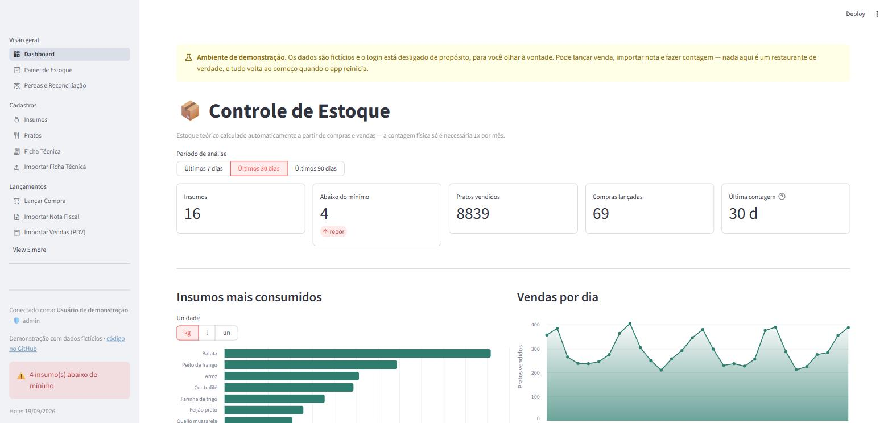

# 📦 Restaurant Inventory Control

*[Leia em português](README.md)*

[](https://github.com/Luisinho13/estoque-restaurante/actions/workflows/testes.yml)

Replaces the weekly manual stock count with an automatic calculation from
purchases and sales. The physical count stops being the Monday routine and
becomes a monthly check.

A personal project, built for a real problem at the restaurant where I work
as the buyer. It went into real use in September 2026.

**▶️ Live demo, no sign-up:**
https://estoque-restaurante-4nhzp9k8m6illpc2cjkg3l.streamlit.app

You go straight in and can try everything: log a sale, import an invoice,
do a stock count. The import screens have a button to download a sample
file and upload it right there. The data is fictional and resets when the
app restarts. The interface is in Portuguese.



## Summary

Stock was controlled with a spreadsheet and a physical count every week:
someone walked the storeroom item by item, wrote everything down and typed
it in. Slow, repetitive, error-prone, and in the end it answered "how much
do I have", when the question that matters for buying is **"what runs out
first"**.

If I know what came in and what went out, I know what is left:

```
current stock = last physical count
              + purchases and productions since that date (inclusive)
              − sales × the dish's recipe, also since that date
              − what each production used of its ingredients
```

- **Two recipes, like the kitchen.** The tomato sauce is made once in an
  80 kg pot and served all week. Selling a parmigiana takes sauce out of
  stock; making the sauce takes the tomatoes. So the ready sauce has its
  own balance, and the tomatoes leave on the day they were used.
- **Purchases** are typed in by hand or imported from the Brazilian
  electronic invoice (NF-e XML). Each supplier product is mapped to an
  ingredient once, with a unit conversion factor.
- **Sales** are entered by hand every day, in a single table for the whole
  day, or imported from the spreadsheet exported by the POS (Zig). There is
  no public POS API, so manual entry is the main path, and that constraint
  shaped the system: re-entering a day replaces it instead of adding to it,
  and the sidebar warns about days with no sales entered.
- **Physical count once a month**, following the spreadsheet the team
  already used, in shelf units (a wheel of parmesan, a bunch of rosemary, a
  bottle) converted to the ingredient's unit.
- **Losses**: between two counts, everything available was either used
  (sales × recipe), left over (current count) or lost. The three add up to
  100%, shown per ingredient and as a percentage. "We lost 12 kg of
  tomatoes" is a loose number; "11% of the tomatoes that came in were
  thrown away, against 1.5% of the potatoes" points straight at where to
  look.
- **What runs out first**: days of stock left per ingredient (stock ÷
  average daily use), with a traffic light against the minimum stock.
- **Login with approval and per-area permissions.** Passwords are stored as
  PBKDF2-SHA256 with a random salt per user.

## Stack

- **Python**
- **Streamlit** for the interface
- **SQLite** locally and **PostgreSQL** in the cloud (Neon). The same code
  runs on both: queries are written once, in SQLite's dialect, and
  `database.py` translates them to Postgres at run time
- **Streamlit Community Cloud** for hosting
- **pandas**, **openpyxl** and **Altair** for the spreadsheets and charts
- **pytest** for the tests

## Results

- The weekly count becomes a monthly one, and that count now measures
  loss, breakage and waste — the gap between theoretical and real stock.
- In real use since September 2026, with 511 ingredients across food
  and drinks, 87 dishes, 546 recipe lines imported from the
  kitchen's spreadsheets and 576 count lines from the stock spreadsheet.
- Against a remote database, what costs is how many times you ask, not the
  size of the question:
  - the dashboard went from ~27 s to 2.1 s, computing the stock of every
    ingredient in one query instead of 109;
  - saving a full stock count went from 1,449 database round trips to 11,
    and a day of sales from 166 to 4;
  - round trips per click went from 55–82 to 12–23, by keeping the
    connection per session instead of per thread.
- The Portuguese README documents 17 problems found along the way, with
  the symptom, the real cause and the fix. Almost none of them raised an
  error: in a system whose job is to say how much is left, the dangerous
  bug is the one that returns a wrong number that looks right.

## Running it

```bash
pip install -r requirements.txt
streamlit run demo.py
```

`demo.py` runs the app on a fictional database, without login. To run with
your own data, use `streamlit run app.py`.

### Tests

```bash
pip install -r requirements-dev.txt
pytest
```

They cover the stock calculation, the NF-e and POS imports, and the SQL
translation to Postgres. Each test runs on a fresh SQLite database in a
temporary folder, and never reaches Postgres. On GitHub they run on every
push (`.github/workflows/testes.yml`).

---

<sub>Created by Luis Souza · © 2026 · All rights reserved. The code is public for reference; use, copying or redistribution require the author's permission.</sub>
